# Basic Network Sniffer in Python (Scapy)


A command-line packet sniffer written in Python with Scapy. It captures live traffic from a network interface and prints, for every packet, the source and destination IP and port, the protocol, the TCP flags and a readable preview of the payload. It also decodes DNS queries, ARP requests and ICMP message types. When the capture ends it prints a short traffic summary and can save everything to a `.pcap` file that opens in Wireshark.

Built for Task 1 of the CodeAlpha Cybersecurity Internship.

**Author:** Ali Abbas Qazi | [LinkedIn](https://www.linkedin.com/in/ali-abbas-qazi) | [GitHub](https://github.com/Ali-Abbas-Qazi)

---

## Contents

1. [Objectives](#1-objectives)
2. [Lab environment](#2-lab-environment)
3. [Repository structure](#3-repository-structure)
4. [How the sniffer works](#4-how-the-sniffer-works)
5. [Installation and usage](#5-installation-and-usage)
6. [Results and analysis](#6-results-and-analysis)
7. [Security observations](#7-security-observations)
8. [Limitations](#8-limitations)
9. [Ethical note](#9-ethical-note)
10. [Conclusion](#10-conclusion)

---

## 1. Objectives

| Task requirement | How this project covers it | Evidence |
|---|---|---|
| Build a Python program to capture network traffic packets | `network_sniffer.py` captures live packets with Scapy's `sniff()` | Fig. 2, Fig. 3, Fig. 4 |
| Analyze captured packets to understand their structure and content | Each packet is broken down by layer (IP, TCP/UDP/ICMP, DNS, payload) | Fig. 4, Fig. 6, Fig. 10 |
| Learn how data flows through the network and the basics of protocols | DNS lookups, ping request/reply pairs, the TCP handshake and a failed connection are traced packet by packet | Fig. 6, Fig. 7, Fig. 8 |
| Use libraries like `scapy` or `socket` | Built on Scapy 2.7 | Fig. 1 |
| Display source/destination IPs, protocols and payloads | Shown on every output line, plus a summary table at the end | Fig. 4, Fig. 5, Fig. 9 |

---

## 2. Lab environment

| Item | Details |
|---|---|
| Operating system | Kali Linux (VirtualBox VM, NAT network mode) |
| Capture interface | `eth0`, IP `10.0.2.15/24`, MAC `08:00:27:5a:87:bc` |
| DNS server / gateway seen in traffic | `192.168.1.1` |
| Language | Python 3.14.8 |
| Packet library | Scapy 2.7 |
| Verification tool | Wireshark |
| Traffic generators | Firefox, `nslookup`, `ping`, `curl` |

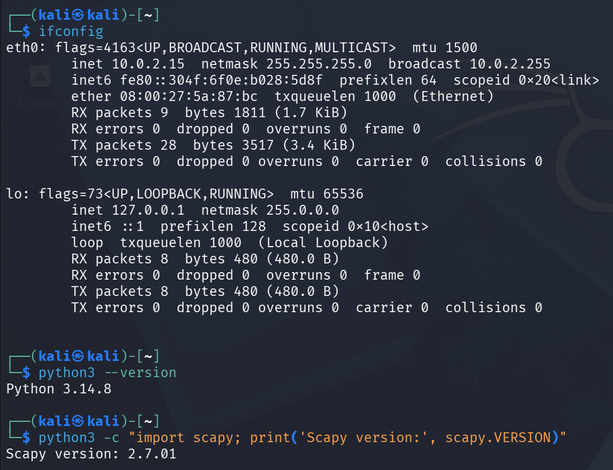
*Figure 1: `ifconfig` showing the `eth0` capture interface, plus the installed Python and Scapy versions.*

---

## 3. Repository structure

```
CodeAlpha_Network_Sniffer/
├── network_sniffer.py      # the sniffer
├── capture.pcap            # 100-packet sample capture used in section 6.6
├── README.md
└── screenshots/
    ├── 01_environment.png
    ├── 02_code_protocol_address.png
    ├── 03_code_payload_processing.png
    ├── 04_live_capture.png
    ├── 05_live_capture_summary.png
    ├── 06_dns_icmp_filter.png
    ├── 07_http_plaintext.png
    ├── 08_failed_tcp_connection.png
    ├── 09_pcap_summary.png
    └── 10_wireshark_verification.png
```

---

## 4. How the sniffer works

### 4.1 Program flow

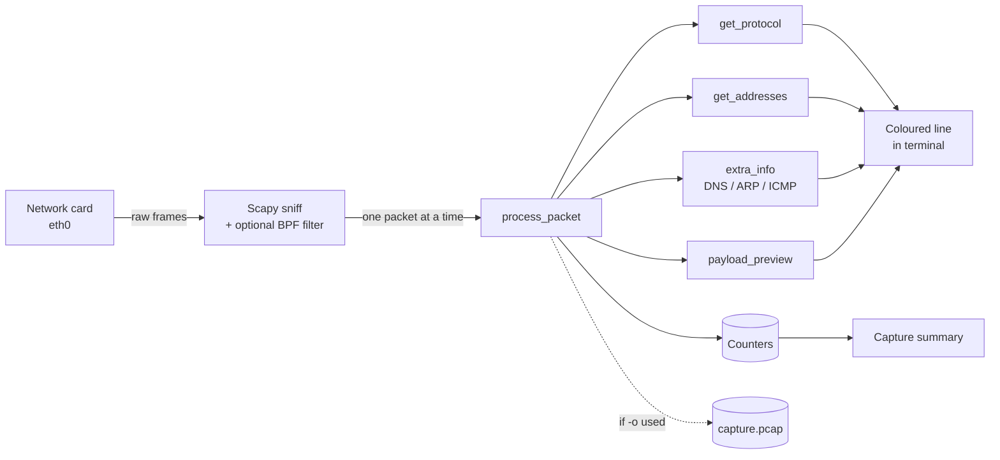

Scapy does the capturing. Every packet it picks up is handed to `process_packet()`, which pulls out the fields I care about, prints one line, and updates the counters used for the summary. Nothing is stored in memory unless `-o` is given, so the sniffer can run for a long time without growing.

### 4.2 What each function does

| Function | Job |
|---|---|
| `get_protocol()` | Labels the packet ARP, DNS, HTTP (port 80), HTTPS (port 443), TCP, UDP, ICMP or OTHER |
| `get_addresses()` | Returns `ip:port` for source and destination. Handles IPv4, IPv6 and ARP, and falls back to MAC addresses |
| `extra_info()` | Decodes the queried domain for DNS, the "who has" question for ARP, and the message type for ICMP (Echo Request, Echo Reply, Unreachable, Time Exceeded) |
| `payload_preview()` | Prints the first 70 bytes of the payload, replacing unprintable bytes with `.` |
| `process_packet()` | Callback that runs once per packet and puts the line together |
| `print_summary()` | Packet count per protocol with percentages, and the top five source addresses |

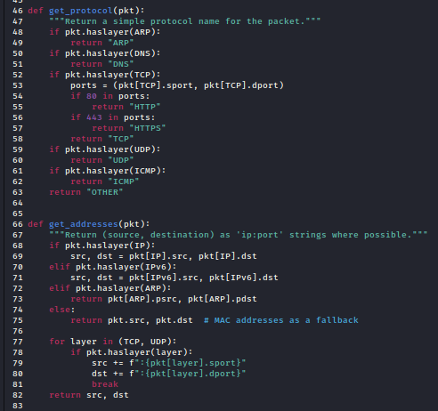
*Figure 2: `get_protocol()` and `get_addresses()`.*

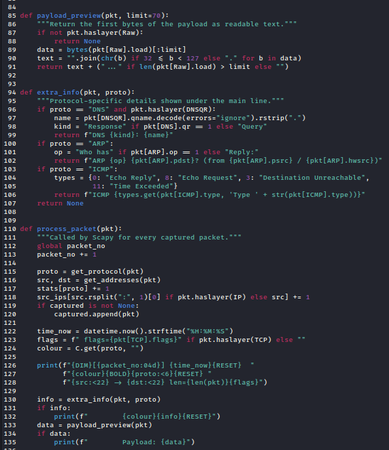
*Figure 3: `payload_preview()`, `extra_info()` and the `process_packet()` callback.*

### 4.3 Packet layers the sniffer reads

| Layer | Header | Fields shown by the tool |
|---|---|---|
| 2 – Data link | Ethernet / ARP | MAC addresses (fallback), ARP requests and replies |
| 3 – Network | IPv4 / IPv6 / ICMP | Source and destination IP, ICMP type |
| 4 – Transport | TCP / UDP | Ports, TCP flags (S, SA, A, PA, F, R) |
| 7 – Application | DNS / HTTP / raw data | DNS query name, payload text |

---

## 5. Installation and usage

On Kali, Scapy is normally already installed. If it isn't, install it with apt so it still works under `sudo`:

```bash
sudo apt update && sudo apt install python3-scapy -y
git clone https://github.com/Ali-Abbas-Qazi/CodeAlpha_Network_Sniffer.git
cd CodeAlpha_Network_Sniffer
```

Packet capture needs root, so every command runs with `sudo`.

| Option | Meaning | Example |
|---|---|---|
| `--list` | List network interfaces | `sudo python3 network_sniffer.py --list` |
| `-i` | Interface to sniff on | `-i eth0` |
| `-c` | Number of packets (0 = run until Ctrl+C) | `-c 40` |
| `-f` | BPF filter | `-f "icmp or udp port 53"` |
| `-o` | Save packets to a pcap file | `-o capture.pcap` |

```bash
# capture 40 packets of any type
sudo python3 network_sniffer.py -i eth0 -c 40

# only DNS and ping traffic
sudo python3 network_sniffer.py -i eth0 -f "icmp or udp port 53" -c 12

# only plain HTTP
sudo python3 network_sniffer.py -i eth0 -f "tcp port 80" -c 10

# capture 100 packets and save them
sudo python3 network_sniffer.py -i eth0 -c 100 -o capture.pcap
```

---

## 6. Results and analysis

### 6.1 Live capture of normal browsing

I started a 40-packet capture and opened a few websites in Firefox.

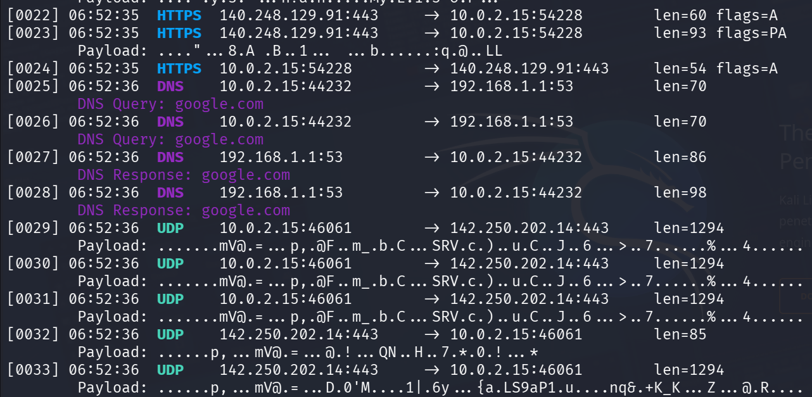
*Figure 4: Live capture with HTTPS, DNS and UDP traffic.*

What Figure 4 shows:

- Packets 22–24 are part of an HTTPS session with `140.248.129.91:443`. The flags show the normal back-and-forth: `PA` (push + ack) when data is sent, `A` when it's acknowledged. The payload is unreadable because TLS encrypts it.
- Packets 25–28 are the DNS lookup for `google.com`. The VM asks `192.168.1.1` on port 53 and gets an answer back on the same source port (44232), which is how the client matches the reply to its question. There are two queries and two responses because the system asks for both an IPv4 (A) and an IPv6 (AAAA) record, which is also why the second response is longer (98 bytes against 86).
- Packets 29–33 are UDP traffic to `142.250.202.14:443`, which section 6.2 confirms is `google.com`. UDP on port 443 is QUIC (HTTP/3), which browsers use with Google services. It's encrypted too, so the payload is noise.

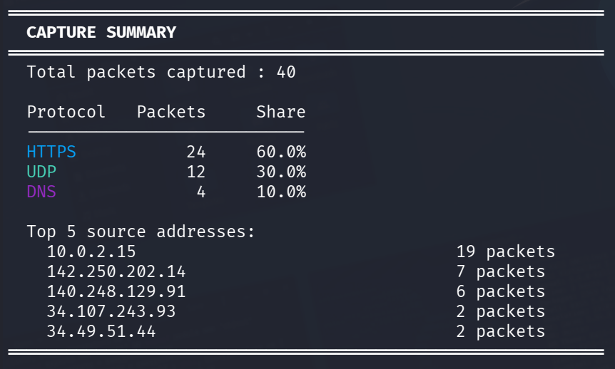
*Figure 5: Summary for the 40-packet capture.*

HTTPS made up 60% of the capture. My own VM (`10.0.2.15`) was the top source with 19 packets. The rest came from the servers replying to it.

### 6.2 DNS and ICMP with a BPF filter

To look at specific protocols on their own, I filtered on `icmp or udp port 53` and ran `nslookup google.com` and `ping -c 4 8.8.8.8` in a second terminal.

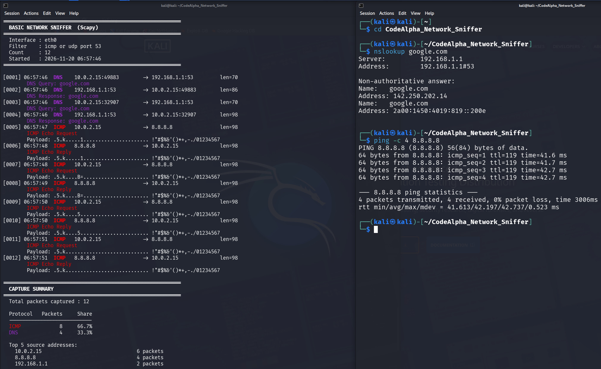
*Figure 6: Filtered capture (left) next to the commands that produced the traffic (right).*

- DNS (packets 1–4): two queries for `google.com` (A and AAAA) and two responses from `192.168.1.1`. `nslookup` on the right shows the answers: `142.250.202.14` and an IPv6 address. That same IPv4 address showed up as the QUIC server in Figure 4, so the lookup and the later connection line up.
- ICMP (packets 5–12): four Echo Request → Echo Reply pairs between `10.0.2.15` and `8.8.8.8`, exactly matching the four replies `ping` reported. The payload `!"#$%&'()*+,-./01234567` is the fixed byte pattern Linux `ping` puts in every request, and the reply carries it back unchanged. That pattern alone is enough to tell the sender is probably a Linux machine.
- The filter worked as expected. All 12 packets were ICMP (8) or DNS (4), with nothing else mixed in.

### 6.3 Plaintext HTTP

Next I filtered on `tcp port 80` and requested a page over plain HTTP with `curl http://detectportal.firefox.com/success.txt`.

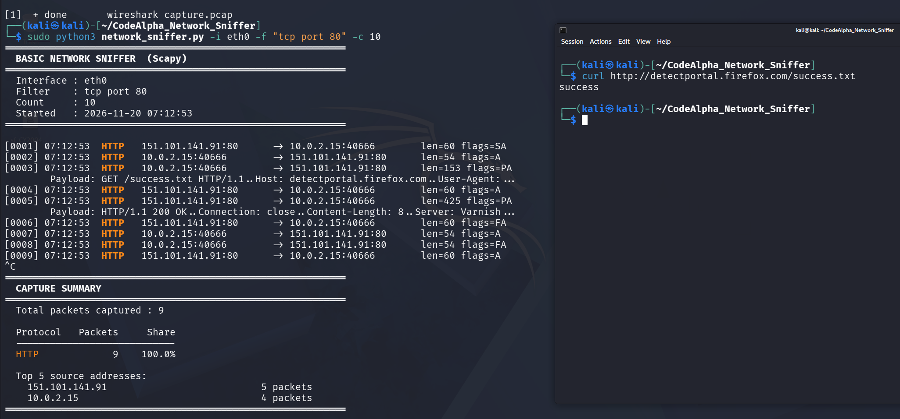
*Figure 7: An unencrypted HTTP request and response. The GET line, headers and server reply are all readable in the payload.*

The whole conversation with `151.101.141.91:80` took nine packets:

| Packets | Flags | What happens |
|---|---|---|
| 1–2 | `SA`, `A` | End of the TCP handshake (server's SYN-ACK, client's ACK) |
| 3 | `PA` | Client sends `GET /success.txt HTTP/1.1..Host: detectportal.firefox.com..User-Agent: ...` |
| 4 | `A` | Server acknowledges the request |
| 5 | `PA` | Server replies `HTTP/1.1 200 OK..Connection: close..Content-Length: 8..Server: Varnish...` |
| 6–9 | `FA`, `A`, `FA`, `A` | Both sides close the connection |

The `..` in the payload are the `\r\n` line breaks, which the preview prints as dots. The reply even gives away the server software (Varnish, a caching proxy) and the size of the body: 8 bytes, which is the word `success` plus a newline, the same text `curl` printed on the right. The client's opening `SYN` is missing because `curl` fired a fraction of a second before the sniffer was ready, so the capture starts at the server's `SA`. Only 9 of the 10 requested packets existed, so I stopped it with Ctrl+C.

Compare that to the HTTPS packets in Figure 4. With HTTPS, someone watching the network sees which IP and port you talk to and nothing else. With HTTP, they can read the request, the headers, any cookies, and anything typed into a form.

### 6.4 A failed TCP connection

My first attempt at the HTTP test went to `neverssl.com`, and the connection never opened. That turned out to be useful to look at too.

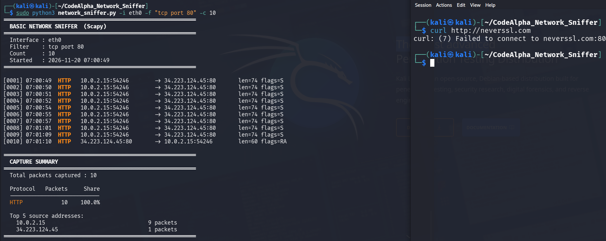
*Figure 8: Repeated SYN packets with no reply, then a reset; `curl` reports "Failed to connect".*

The VM sent a `SYN` to `34.223.124.45:80` nine times from the same source port. The gaps start at a second or two and then stretch to 4 s and 8 s, because TCP waits longer before each retry when it gets no answer. The last packet is `RA` (reset + ack) coming back, which ended the attempt, and `curl` gave up with error 7. There was no `SA` reply, so the handshake never completed and no payload was ever sent. Seen from the network, this is what a blocked or unreachable service looks like, and it's the same pattern an analyst looks for when checking firewall drops or a port scan hitting closed ports.

### 6.5 Saving a capture

I ran a 100-packet capture with `-o capture.pcap` while browsing to `www.kali.org`.

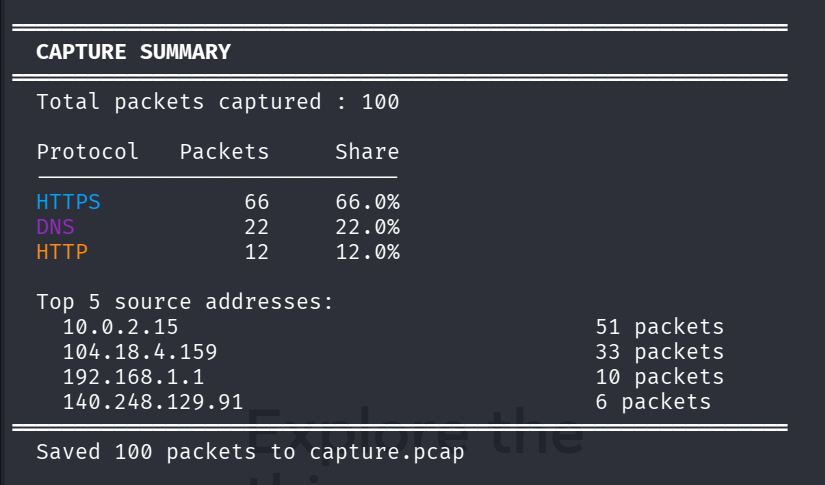
*Figure 9: Summary of the 100-packet capture, saved to `capture.pcap`.*

| Protocol | Packets | Share |
|---|---|---|
| HTTPS | 66 | 66% |
| DNS | 22 | 22% |
| HTTP | 12 | 12% |

### 6.6 Checking the result in Wireshark

To check that the sniffer reports traffic correctly, I opened `capture.pcap` in Wireshark and compared it packet by packet with the tool's summary.

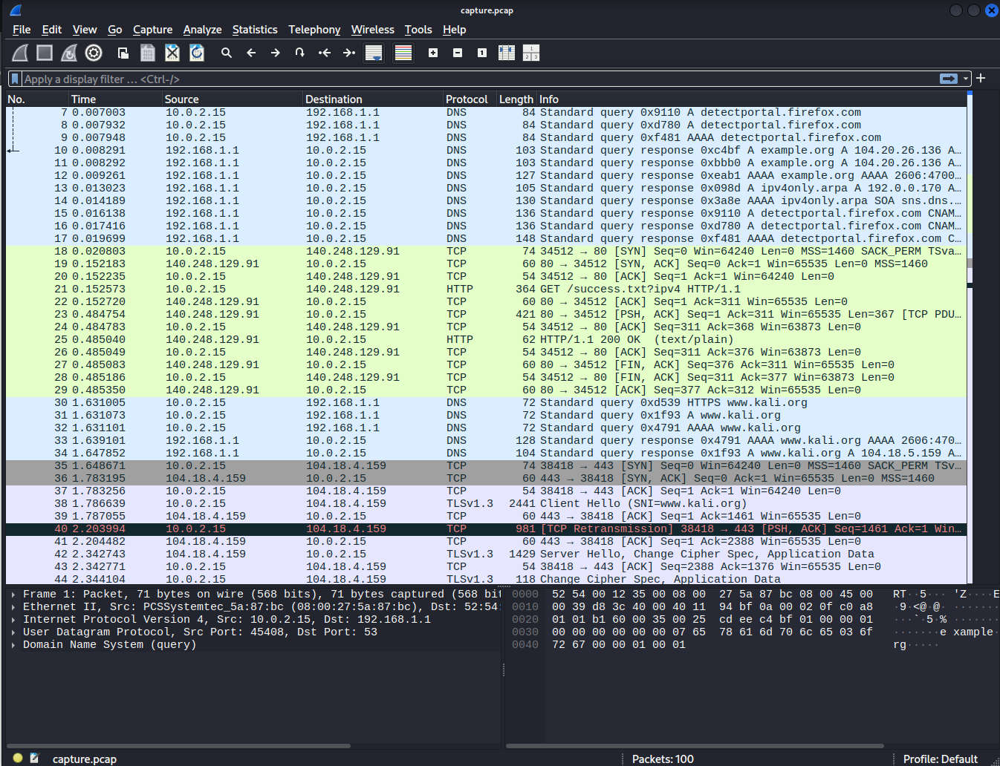
*Figure 10: `capture.pcap` in Wireshark. 100 packets, with frame 1 broken down layer by layer at the bottom.*

| Tool label | Tool count | Wireshark frames | Wireshark count | Match |
|---|---|---|---|---|
| DNS | 22 | 1–17 and 30–34 | 22 | Yes |
| HTTP | 12 | 18–29 | 12 | Yes |
| HTTPS | 66 | 35–100 | 66 | Yes |

All three counts match. Wireshark also gives more detail on the same packets:

- Frames 18–29 are a full HTTP conversation with `140.248.129.91`: handshake (`SYN`, `SYN, ACK`, `ACK`), `GET /success.txt?ipv4`, `HTTP/1.1 200 OK`, then the `FIN` teardown. This is Firefox's captive-portal check, which it runs over plain HTTP on purpose.
- Frame 38 is a TLS `Client Hello` with `SNI=www.kali.org`. HTTPS hides the content, but the name of the site still goes out unencrypted during the handshake.
- The layer breakdown of frame 1 matches section 4.3: Ethernet II (VirtualBox MAC `08:00:27:5a:87:bc`), IPv4 `10.0.2.15 → 192.168.1.1`, UDP port 53, DNS query.

---

## 7. Security observations

| # | Observation | Why it matters | Evidence |
|---|---|---|---|
| 1 | HTTP payloads are fully readable | Credentials, cookies and form data sent over HTTP can be read by anyone on the same network (public Wi-Fi, a compromised router). Sites should force HTTPS and use HSTS | Fig. 7, Fig. 10 |
| 2 | DNS queries go out in plaintext | Anyone on the path can see every domain a user looks up, even if the sites use HTTPS. DNS over HTTPS/TLS fixes this | Fig. 4, Fig. 6 |
| 3 | HTTPS still leaks the site name through SNI | Encryption hides the content but not the destination. Encrypted Client Hello (ECH) addresses this, but only some browsers and servers use it so far | Fig. 10 |
| 4 | Ping payloads identify the OS | The fixed Linux byte pattern lets an observer guess the sender's OS, which is basic passive fingerprinting | Fig. 6 |
| 5 | Unanswered SYNs show up clearly | Repeated SYNs with no `SA` point to a blocked or dead service. The same pattern spread across many ports is how a SYN scan shows up to an IDS | Fig. 8 |

---

## 8. Limitations

- The tool labels by port. It calls anything on port 80 "HTTP" and anything on 443 "HTTPS", even pure handshake packets with no application data. Wireshark labels most of those as plain TCP. QUIC on UDP 443 just shows as "UDP".
- Only the first 70 bytes of each payload are printed, to keep the output readable. The full packet still goes into the pcap.
- It sniffs one interface at a time, and the summary only appears once the capture stops.
- Raw packet capture needs `sudo` on Linux (or Administrator rights and Npcap on Windows).
- In VirtualBox NAT mode the VM only sees its own traffic. Watching other devices on the LAN would need bridged mode plus port mirroring on the switch.

---

## 9. Ethical note

All traffic in this report was generated by me, on my own virtual machine and home network. Capturing other people's traffic without permission is illegal in most countries, including under Pakistan's Prevention of Electronic Crimes Act (PECA) 2016. Only run a sniffer on networks you own or are authorised to monitor.

---

## 10. Conclusion

The sniffer captures live traffic on Kali, reports IPs, ports, protocols, TCP flags and payloads for each packet, and its counts matched Wireshark exactly on a 100-packet capture. Building it made a few things concrete that I had mostly only read about. The TCP handshake and retry behaviour are obvious once the flags are printed next to each packet. HTTPS does less for privacy than people assume, since DNS and SNI still reveal which sites are visited. And seeing a GET request show up as plain text in my own terminal was a better argument for HTTPS than any slide I've seen.

The next step is turning this kind of visibility into detection, which is what Task 4 (a Snort/Suricata IDS) covers.
